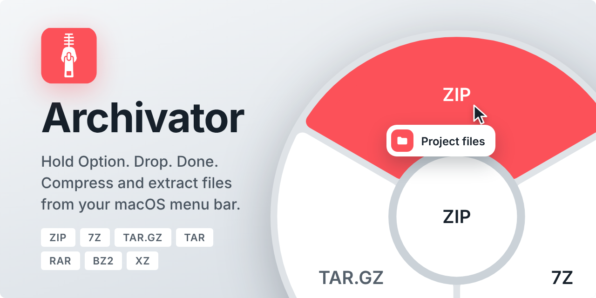
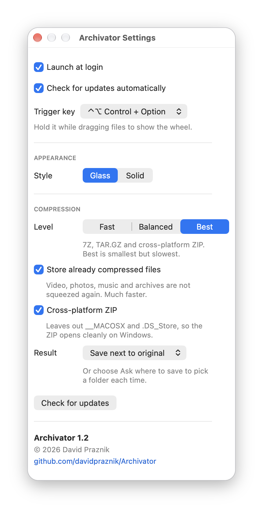

  

  Hold <b>⌥ Option</b> while dragging files to compress or extract them. 
  Lives in your menu bar and is built to be energy efficient: it only does work while you are using it. The result is saved next to the original.

  
  
  

## Energy efficient

Archivator is optimised for low energy use. It only listens for a mouse press. Drag detection runs only while the mouse button is held down and stops as soon as you release it, and the CPU is busy only while an archive is being made or extracted. Apart from the optional update check (once a day), nothing runs in the background, so an idle Archivator does not drain your battery.

## Formats

| Action | Formats |
| --- | --- |
| Compress | ZIP, 7Z, TAR.GZ |
| Extract | ZIP, 7Z, TAR, TGZ, GZ, BZ2, XZ, RAR |

Several files can be dropped at once. If a name is already taken, a number is added (`Project 2.zip`). Existing files are never overwritten.

## Usage

1. Start Archivator. It lives in the menu bar.
2. Drag one or more files or folders from Finder.
3. While dragging, hold **⌥ Option**. The wheel opens at the cursor.
4. Drop on a segment.

If everything you drag is an archive, the wheel offers **Extract here** (into a new folder next to the archive) and **Extract to…** (you choose the folder). Otherwise it offers the three compression formats.

Dropping on the centre or between segments does nothing.

While a job runs, the centre of the wheel shows the progress: a percentage when several files are compressed, the size written so far for a single file, or the elapsed time when extracting. You can drag the wheel out of the way by its disk. Press **Esc** to cancel a running job. The trigger key can be changed to **⌃ Control** or **⌃⌥ Control + Option** in Settings (**⇧ Shift** and **⌘ Command** are used by [Konverter](https://github.com/davidpraznik/Konverter)).

## Settings

Menu bar icon, Settings…

- Launch at login, check for updates (GitHub releases, optional automatic check once a day).
- **Trigger key**: ⌥ Option (default), ⌃ Control or ⌃⌥ Control + Option.
- **Style**: *Glass* (translucent wheel carrier) or *Solid* (the classic look).
- **Compression**: level (Fast, Balanced, Best), *store* files that are already compressed (video, images, archives) instead of compressing them again, cross-platform ZIP (no `__MACOSX` or `.DS_Store` entries), and whether the result is saved next to the original or you choose the folder each time.

  

## Security

Extraction uses the system `tar` (libarchive) without the option that preserves absolute paths. Entries with `..` in the path are refused, absolute paths are made relative, and writing through symbolic links that point outside the target folder is refused. If an archive contains such an entry, extraction stops and the partly extracted folder is removed.

## Requirements

- macOS 14.6 or later (tested on macOS 27 only)
- Xcode to build from source

## Opening a downloaded build

Builds from GitHub are not notarized, so macOS blocks the app on first launch. To open it:

1. Try to open Archivator once and close the warning.
2. Open **System Settings > Privacy & Security** and scroll to the bottom.
3. Click **Open Anyway** next to the message about Archivator, then confirm.

This is needed only once.

## Build

1. Clone the repository and open `Archivator.xcodeproj`.
2. Run.

The app does not use the App Sandbox. Detecting a file drag needs no special permissions.

## Works with Konverter

Konverter uses **⇧ Shift** and **⌘ Command** while dragging. Archivator uses **⌥ Option** by default (changeable in Settings) and never reacts to Shift or Command, so both can run at the same time.

## About

I am a UX/UI and product designer. I made Archivator for my own needs, as a companion to [Konverter](https://github.com/davidpraznik/Konverter): the same wheel, the same way of working, but for compressing and extracting files. Many open source tools have helped me deliver my work over the years, so I am sharing this one publicly to give something back. It is free and MIT licensed. Bug reports and ideas are welcome in [Issues](https://github.com/davidpraznik/Archivator/issues).

## Third-party components

- [Inter](https://rsms.me/inter/) (SIL Open Font License 1.1), interface typeface. The licence is included as `Inter-LICENSE.txt`.

## Licence

MIT, see [LICENSE](LICENSE). © 2026 David Praznik.
